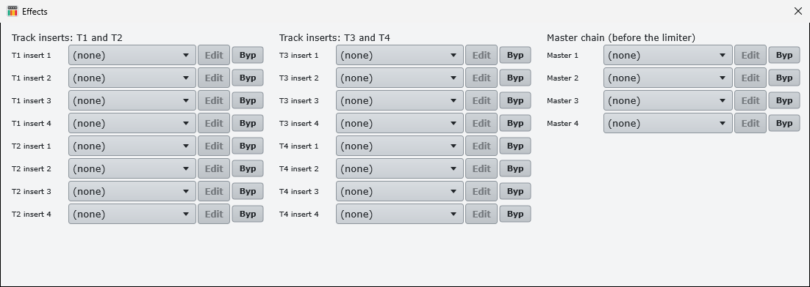

# KeyStepPro Studio

A free desktop companion for the **Arturia KeyStep Pro**: edit its sequencer patterns on a big screen, keep a library of
projects on your computer, and play the KeyStep through your own VST3 instruments without opening a DAW.


Windows (tested) and macOS (builds from the same code, not tested lately). Not affiliated with Arturia.

## What it does

- **Pattern editor.** Read a project from the KeyStep over USB (or open a backup), see all 64 steps of every pattern,
  add, delete and edit notes (pitch, gate, velocity, time shift, randomness), change length, root and scale, copy patterns,
  shift a track by an octave, and write the result back to the KeyStep.
- **Overdub.** Press Rec, hit Play on the KeyStep and play over the loop; notes land on the nearest step.
- **Library.** Your projects live on the computer (`Documents/KeyStepPro Studio/Library`), with names, notes and the
  instruments of each track. The KeyStep's 16 slots are treated as a working area: open and edit projects without the
  KeyStep connected, load one into a slot when you want to play it.
- **VST3 host.** One VST3 instrument per KeyStep track (T1 to T4 on MIDI channels 1 to 4), up to four effect inserts per
  track and a master effect chain with a limiter. The KeyStep is the clock: its Play and Stop drive the app.
- **WAV recording** of the mix and/or one stem per track, started and stopped by the KeyStep's transport.
- **Ambient generator** (Generate...): writes evolving patterns and scenes into the open project, with moods, a seed,
  pattern chains and undo.
- **Backups.** Full read-only backup of all 16 projects and the global settings to JSON (the same format as
  [KSCON](https://github.com/canadianblaken/keystep-con), so backups open in either tool).
- **Project Map.** Scenes by tracks with a mini piano roll in each cell, the chain timeline and the pattern bank.
- **MIDI monitor** to see what each control of the KeyStep sends.




## Safety first

The app talks to the KeyStep with Arturia's undocumented SysEx protocol (mapped by KSCON). To protect your device:

- It only **writes** to a KeyStep Pro running **firmware 2.5.20** (the current official one). On any other firmware it can
  still read, but refuses to write.
- It writes to any of the 16 slots (working memory). Before every write it **backs up** the slot to
  `Documents/KeyStepPro Studio/Backups`, and after it **reads the slot back** and compares every value.
- It reads what is **saved in flash**, not the live state: save your project on the KeyStep before reading it.
- Close **MIDI Control Center** first (on Windows the USB MIDI port can only be open in one program).

Still, this is a hobby project with no warranty. Make a full backup (`KspBackup`, or MIDI Control Center) before you
start writing to your KeyStep.

## Install (Windows)

1. Download `KeyStepProStudio-Setup-x.y.z.exe` from [Releases](../../releases) and run it. It installs the app, the
   plugin scanner and the command-line tools, and adds a Start menu entry.
2. The installer and the app are **not code-signed** (see [docs/signing.md](docs/signing.md)). Windows SmartScreen will
   say "Windows protected your PC": click **More info** and then **Run anyway**. Each release lists the SHA-256 of its
   files so you can check what you downloaded:
   `Get-FileHash .\KeyStepProStudio-Setup-x.y.z.exe -Algorithm SHA256`.
3. Connect the KeyStep Pro by USB, close MIDI Control Center and start **KeyStepPro Studio**.

## Quick start

1. **Read slot N from KeyStep** (or **Open backup...**) and pick a project. The grid shows track 1, pattern 1.
2. Click an empty cell to add a note, right-click a note to delete it, drag the knobs under the grid to edit the
   selected note. Switch track and pattern at the top.
3. **Save** keeps the project in your library. **Write to slot** sends it to a slot from 10 to 16 (backed up and
   verified as described above).
4. To play it through VST3 instruments: **Scan plugins** once, pick an instrument per track in the rows under the grid,
   choose your audio device with **Audio...**, and press Play on the KeyStep.

**New to the app?** Start with the [User guide](docs/manual/user/README.md). Developer notes: [docs/manual](docs/manual/README.md).

## Command-line tools

Installed next to the app; useful for backups and troubleshooting.

| Tool | Writes to the KeyStep? | Use |
| --- | --- | --- |
| `KspProbe` | no | Connection test: firmware, MIDI settings, the patterns of a project. |
| `KspBackup` | no | Backup of all projects and the global settings to JSON (about 10 minutes). |
| `KspRestore` | only with `--write` | Restore a project from a backup to a slot (backup first, read back after). |
| `KspGen` | only with `--write` | Generate an ambient project into a slot 10-16. |
| `KspHostCheck` | no | Check that a VST3 instrument or effect loads, sounds and restores its state. |

Details in [docs/manual/02-tools.md](docs/manual/02-tools.md).

## Build from source

Requirements: CMake 3.22+, a C++17 compiler (Visual Studio 2022 or newer on Windows, Xcode on macOS) and Git. JUCE 8.0.4 is
downloaded automatically.

```
cmake -S . -B build -DCMAKE_BUILD_TYPE=Release
cmake --build build --config Release
```

The app ends up in `build/KeyStepProStudio_artefacts/Release/`. Use `-DJUCE_DIR=path/to/JUCE` to build with a local
JUCE instead of downloading it.

Tests that need neither JUCE nor a KeyStep:

```
cmake -S . -B build-tests -DKSP_TESTS_ONLY=ON
cmake --build build-tests
ctest --test-dir build-tests
```

To build the Windows installer, see [installer/README.md](installer/README.md).

## Status and limits

Working and used live: pattern editing, the library, the VST3 host, recording and the generator. Not done yet: drum
patterns, the arpeggiator, editing scenes and plugin latency compensation. Only VST3 plugins are hosted (no AU, no VST2).

## Credits and license

- The SysEx protocol and the backup format come from [KSCON](https://github.com/canadianblaken/keystep-con) by
  canadianblaken (MIT). See [THIRD_PARTY_NOTICES.md](THIRD_PARTY_NOTICES.md).
- Built with [JUCE](https://juce.com) (AGPLv3) and the Steinberg VST3 SDK.
- KeyStep Pro and MIDI Control Center are trademarks of Arturia. This project is not affiliated with or endorsed by Arturia.

Licensed under the GNU Affero General Public License v3.0, see [LICENSE](LICENSE).
