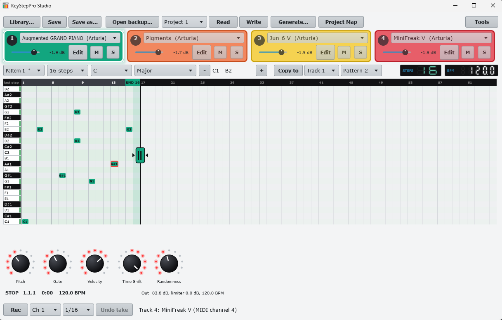

# 1. Install and first run

**You will:** install the app, start it, and see the main window.

## Install (Windows)

1. Download `KeyStepProStudio-Setup-x.y.z.exe` from the [Releases](../../../../../releases) page and run it.
   No installer wanted? Download `KeyStepProStudio-x.y.z-portable.zip`, unzip it anywhere and run `KeyStepPro Studio.exe`
   (your data still goes to `Documents\KeyStepPro Studio\`).
2. Windows SmartScreen says *"Windows protected your PC"* because the file is not code-signed (see [signing](../../signing.md)).
   Click **More info → Run anyway**.
3. Optional: check the download. Open PowerShell in the folder and run
   `Get-FileHash .\KeyStepProStudio-Setup-x.y.z.exe -Algorithm SHA256`; the result must equal the line for that file in
   `SHA256SUMS.txt` on the release page. The release notes also link the VirusTotal scans.
4. Start **KeyStepPro Studio** from the Start menu (installer) or run the exe (zip).

The installer also adds `KspVstHelper.exe` (VST3 helper) and the command-line tools.

## First run

- With no KeyStep connected, the app opens your most recent **Library** project. On a fresh install the library is empty,
  so use **Open backup...** or connect the KeyStep ([chapter 2](02-connect.md)).
- Everything the app stores is in `Documents\KeyStepPro Studio\`:

| Folder / file | What |
| --- | --- |
| `Library\` | your projects (`.kspstudio` + `index.json`) |
| `Backups\` | automatic backups of slots, made before each write |
| `Recordings\` | WAV files |
| `KnownPlugins.xml`, `HiddenPlugins.xml` | the VST3 list |

**Watch out:** the first time you run **Scan plugins**, Windows may ask once to allow `KspVstHelper.exe`. Allow it.
