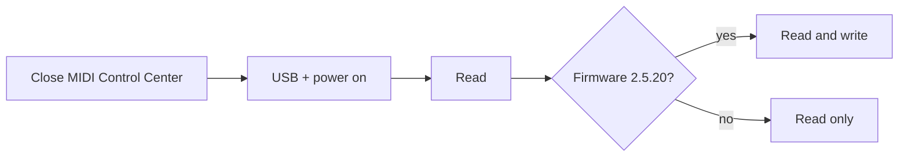

# 2. Connect the KeyStep

**You will:** connect the KeyStep Pro by USB and let the app read it.

1. **Close Arturia MIDI Control Center.** On Windows a USB MIDI port can only be open in one program.
2. Connect the KeyStep Pro by USB and switch it on.
3. In the app pick a project (slot) in the **Project** box and press **Read** (top bar).

The app first reads the device identity. It only **writes** if the firmware is **2.5.20** (the current official one);
on any other version you can still read, but writing is refused.

> **Screenshot pending:** `shot-connect.png` — top row with the KeyStep connected.

**Watch out:**

- The app reads what is **saved in flash**. Save the project on the KeyStep first, then read.
- Reading is slow (the KeyStep's USB speed, not the app).
- Not found? Make sure no other program (MIDI Control Center, a DAW) holds the port, and replug the USB cable.
