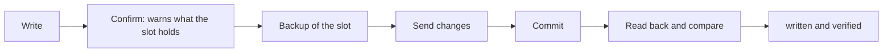

# 3. Read and write slots

**You will:** bring a KeyStep project into the app, edit it, and put the result back.

## Read

Pick a project (slot) in the **Project** box and press **Read** next to it. Reading replaces the project in the editor, so write or save first. The grid fills with that project. Nothing on the device changes.

While the app reads or writes the KeyStep, a popup with a progress bar blocks the whole window so nothing can be touched.

## Write

1. The project goes back to the slot it came from (any of the 16; they are working memory). Use **Save as...** to keep it as another project.
2. Press the blinking **Write** button (next to **Read** in the top bar). The app tells you what that slot holds now and asks you to confirm.
3. It **backs up** the slot, writes only what differs, then **reads it back** and compares every value.
4. The result says **"written and verified"**, or lists the values that differ.

The button **blinks** while there are edits not yet on the KeyStep, also after you saved to the Library or cancelled a
close. A write takes about 75 s.

> **Screenshots pending:** `shot-write-confirm.png`, `shot-write-done.png`.

**Watch out:**

- Do not unplug the KeyStep during a write.
- The KeyStep's memory is volatile working space; the Library is your real copy ([chapter 8](08-library.md)).
- After writing, select that project on the KeyStep to play it.
