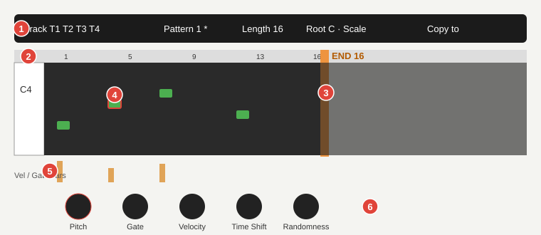
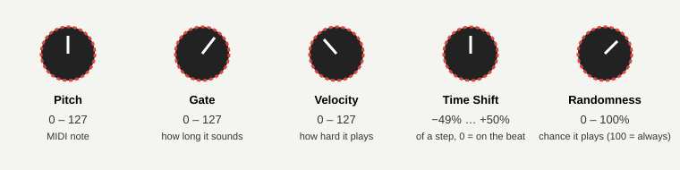
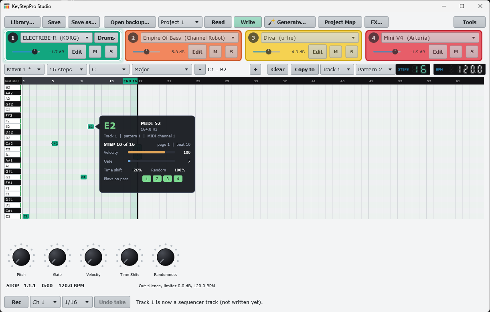

# 5. The pattern grid

**You will:** add, select and edit notes in a pattern.

| # | What | How |
| --- | --- | --- |
| 1 | **Top row** | Track (T1-T4), pattern (`*` = has notes), length, root, scale, Copy to, Track -8va / +8va |
| 2 | **Ruler** | Numbers the 64 steps. Click or drag on it to set the **last step** (the pattern length, 1-64) |
| 3 | **END flag** | The orange line: steps after it are dimmed; the KeyStep does not play them (the notes are kept). **Drag it** left or right to change the length: it has a grip, lights up and shows a resize cursor on hover, snaps to the step lines and updates the grid live |
| 4 | **Notes** | The selected note has a red outline |
| 5 | **Vel / Gate bars** | Velocity and gate of every step at a glance |
| 6 | **Knobs** | Edit the selected note |

## Add, select, delete

- **Left click** an empty cell: adds a note (up to 16 per step). New notes take the pattern's default gate and
  velocity, and the track's instrument plays it briefly so you hear what you put.
- **Left click** a note: selects it.
- **Right click** a note: deletes it.
- **Note names:** every key in the left column is named (the Cs in bold, middle C = C3 as on the KeyStep Pro), and
  every note in the grid shows its name. Rows that belong to the pattern's **root + scale** get a green strip on the
  key and a faint green tint (Chromatic tints all; the User scales tint nothing).
- **-/+** beside the grid move the view by an octave (two octaves are shown).

## Change the length by dragging END

Look for the **grip** on the END line (a small rounded box with three bars and an arrow on each side, half way down the grid), or point at the **END** flag or the line itself: it lights up and the cursor becomes a left-right arrow. Press and
drag; the marker snaps to each step line, the length box updates as you move, and the dimmed area follows live. It
stays between 1 and 64 steps. The change marks the project as edited (write it to the slot to send it to the
KeyStep). The **Length** box in the top row does the same by number.

## The knobs

Drag up/down (hold **Shift** for fine), or use the mouse wheel. They are dark until a note is selected.

| Knob | Range | Meaning |
| --- | --- | --- |
| **Pitch** | 0-127 | MIDI note |
| **Gate** | 0-127 | How long the note sounds (the value the KeyStep stores) |
| **Velocity** | 0-127 | How hard it plays |
| **Time Shift** | -49% to +50% of a step | Moves the note off the beat; 0 = exactly on the step |
| **Randomness** | 0-100% | Chance the note plays on each pass; 100 = always |

## Drums (track 1 in drum mode)

When track 1 is in drum mode (set on the KeyStep, or by a generated style) its grid shows 24 drum lanes instead of
notes, kick at the bottom, each named after the KeyStep's default drum map (kick 36, snare 38, clap 39, closed hat 42,
open hat 46 ...). Click a cell to add or remove a hit and drag to paint more; the mouse wheel on a hit changes its
velocity (darker = louder); click a lane name to hear it. END and the length box work as for notes. Root, scale,
octave, the knobs, Rec and Copy do not apply to drums. The KeyStep holds up to 192 hits per pattern.

## Hover card

Rest the mouse on a step with notes: a card shows the note (name, number, frequency), track, pattern, MIDI channel,
step and page, velocity, gate, time shift, randomness and the four **passes** it plays in.

The full grid, with note names on keys and notes and the rows in the pattern's scale tinted, is in the [main window](../../images/main-window.png).
> **Coming:** dragging steps to move them.

**Watch out:** edits live in memory until you **Save** (Library) and **Write to slot** (KeyStep). Switching pattern or
track keeps them.
