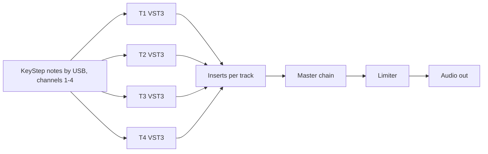
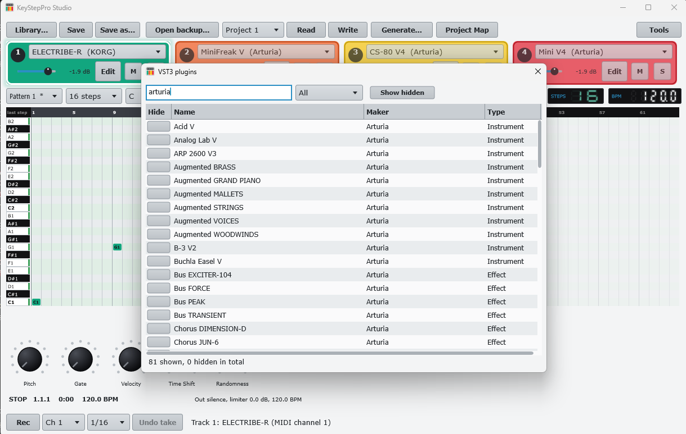

# 6. Tracks and instruments (VST3)

**You will:** give each KeyStep track a VST3 instrument and hear the sequencer through your computer.

## One time: scan your plugins

**Scan plugins** checks your VST3 folders one file at a time in a separate process, so a plugin that crashes cannot
take the app down. The first scan takes a few minutes. **Plugins...** lists the results (type in the box to filter by name or maker); tick **Hide** on the ones you
never want offered (they are hidden, not deleted; **Show hidden** brings them back into view).

## Per track

Above the grid there are four cards, one per track, each in the track's own color (T1 green, T2 orange, T3 yellow,
T4 red) so you can tell tracks apart at a glance. The card of the selected track is full color with a thick white border; the
others are dimmed. Click anywhere on a card (its controls too) to select its track; the pointer turns into a hand over the cards you can select. Each card has:

- a dot with the track number and the instrument list,
- a volume slider with its level in dB,
- **Edit**, which opens the plugin's own window,
- **M**, which mutes (lights red), and **S**, which solos (lights blue): while any track is soloed only the soloed tracks sound (you can solo
  several).

Notes arrive on the track's MIDI channel (T1 = 1 ... T4 = 4, the KeyStep defaults). **Audio...** picks the output
device; **Test note** plays a C3 on every loaded instrument without the KeyStep.

**FX...** opens four insert slots per track and a master chain of four; each has **Edit** and **Byp** (bypass). A master
limiter sits at the end. The label under the rows shows the output peak, limiter reduction and the BPM read from the
KeyStep's clock.

> **Screenshots pending:** `shot-instruments.png`, `shot-plugins.png`.

**Watch out:** a plugin missing on this machine shows **Missing: name** and is kept untouched in the project.
Plugin latency is not compensated yet.
