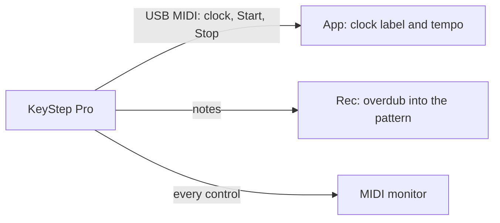

# 6. Track cards and the clock

**You will:** pick a track, switch its mode and read the KeyStep's clock.

## Per track

This chapter is what the **Lite** edition shows. The Full edition adds the instrument, fader, mute and solo to each card ([chapter 6b](06b-instruments.md)).

Above the grid there are four cards, one per track, each in the track's own color (T1 green, T2 orange, T3 yellow,
T4 red) so you can tell tracks apart at a glance. The card of the selected track is full color with a thick white border; the
others are dimmed. Click anywhere on a card (its controls too) to select its track; the pointer turns into a hand over the cards you can select. Each card has:

- a dot with the track number,
- **Seq** and **Arp** keys (**Seq** and **Drum** on track 1), lit for the mode the track is in; see the grid chapter,
- on tracks 2-4, the arpeggiator settings: mode, octave, division and swing.

Each track sends on its own MIDI channel (T1 = 1 ... T4 = 4, the KeyStep defaults; drums on 10, or the channel the project sets in
the **Project Map**). **Rec** records from the channel chosen next to it.

## The clock

The label under the grid shows what the KeyStep's MIDI clock says: **PLAY** or **STOP**, the position since the last Start
(bar.beat.sixteenth), the time and the tempo. The tempo also shows next to the pattern length (`---` until a clock arrives).
They need the KeyStep's MIDI port open: **Read** (or the **MIDI monitor** in **Tools**) opens it.

**Watch out:** in the Lite edition the app does not make sound. Play the KeyStep through its own outputs or your DAW; the app edits what the KeyStep plays.
