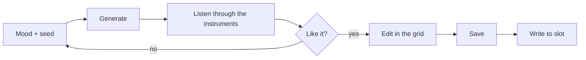

# 7. Generate

**You will:** create ambient patterns and scenes with one button, then listen and edit.

1. Open (or create) a project; **Generate...** needs one open.
2. Pick a **mood**: Classic, Ethereal, Dark or Meditative.
3. Set the **seed**. Same seed = same music. **New seed** rolls a number.
4. Choose whether the scenes **chain** variations and whether time divisions are **slow**.
5. Press **Generate into this project**.

It replaces patterns 1-4 of the four tracks and scenes 1-8 of the open project. Drums, the arpeggiator and other
patterns are left alone. **Undo** restores the project as it was before the last generation.

> **Screenshot pending:** `shot-generate.png`.

**Watch out:** the mood and seed are saved with the project, so you can come back to the same music. Generating changes
the project in memory only; it reaches the KeyStep when you **Write to slot**.
