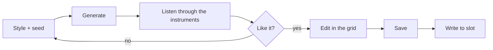

# 7. Generate

**You will:** create patterns and scenes (ambient, techno, house or drum & bass) with one button, then listen and edit.

1. Open (or create) a project; **Generate...** needs one open.
2. Pick a **style** and its **mood**: Ambient (Classic, Ethereal, Dark, Meditative), Techno (Driving), House (Deep,
   Chill, Melodic) or Drum & bass (Liquid).
3. Set the **seed**. Same seed = same music. **New seed** rolls a number.
4. Choose whether the scenes **chain** variations and (Ambient only) whether time divisions are **slow**. For a style, leave
   **Musical arrangement** on (see below) or turn it off for the simple four-scene version.
5. Press **Generate into this project**.

**Ambient** replaces patterns 1-4 of the four tracks and scenes 1-8 of the open project. Drums, the arpeggiator and other
patterns are left alone.

**Techno, House and Drum & bass** put track 1 in drum mode and write its drum patterns 1-4 (the last one ends with a
fill), plus patterns 1-4 of track 2 (bass), track 3 (chords) and track 4 (lead), and scenes 1-4. The drums use the
KeyStep's default drum map (kick 36, snare 38, clap 39, closed hat 42, open hat 46), so load a General MIDI style kit on
track 1; the app sends track 1 to its instrument on the drum channel (10). The project also gets the style's tempo
(techno 130; house deep 128, chill 118, melodic 124; drum & bass 174 BPM); change it on the KeyStep if you like. Track 1 then shows the drum grid (see *The grid*).

**Musical arrangement** (Techno, House, Drum & bass; on by default) writes eight scenes with an energy curve instead of the
same energy everywhere: 1 intro, 2 groove or build, 3 drop, 4 drop variation, 5 breakdown, 6 build, 7 drop 2 or peak, 8 outro.
Track 1 gets five drum patterns (1 kick and hats, 2 with a backbeat, 3 full, 4 full with a fill, 5 breakdown without kick);
tracks 2-4 get twelve patterns (four energy levels for each of three chords: 1-3 sparse, 4-6 groove, 7-9 full, 10-12 peak),
and pattern 16 of every track is empty, to silence a track. Each scene chains four patterns per track (four bars) that move
between levels, and all four tracks play the same chord in a scene. The KeyStep does not change scenes by itself: you play
them live, so think of the eight scenes as a map. The Mood and seed still change the notes.

**Undo** restores the project as it was before the last generation.

> **Screenshot pending:** `shot-generate.png`.

**Watch out:** the style, mood and seed are saved with the project, so you can come back to the same music. Generating changes
the project in memory only; it reaches the KeyStep when you **Write to slot**.
