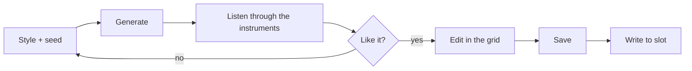

# 7. Generate

**You will:** create patterns and scenes (ambient, techno, house or drum & bass) with one button, then listen and edit.

1. Open (or create) a project; **Generate...** needs one open.
2. Pick a **style** and its **mood**: Ambient (Classic, Ethereal, Dark, Meditative), Techno (Driving), House (Deep,
   Chill, Melodic) or Drum & bass (Liquid).
3. Set the **seed**, the take number: the style sets the rules and the seed picks one version of them. Same style and
   seed = the same music back; another seed = other melodies and rhythms in the same key and tempo. **New seed** rolls a
   number. The window explains it under the seed box.
4. Choose whether the scenes **chain** variations and (Ambient only) whether time divisions are **slow**.
5. Press **Generate into this project**.

**Ambient** replaces patterns 1-4 of the four tracks and scenes 1-8 of the open project. Drums, the arpeggiator and other
patterns are left alone.

**Techno, House and Drum & bass** put track 1 in drum mode and write its drum patterns 1-4 (the last one ends with a
fill), plus patterns 1-4 of track 2 (bass), track 3 (chords) and track 4 (lead), and scenes 1-4. The drums use the
KeyStep's default drum map (kick 36, snare 38, clap 39, closed hat 42, open hat 46), so load a General MIDI style kit on
track 1; the app sends track 1 to its instrument on the drum channel (10). The project also gets the style's tempo
(techno 130; house deep 128, chill 118, melodic 124; drum & bass 174 BPM); change it on the KeyStep if you like. Track 1 then shows the drum grid (see *The grid*).

**Undo** restores the project as it was before the last generation.

> **Screenshot pending:** `shot-generate.png`.

**Watch out:** the style, mood and seed are saved with the project, so you can come back to the same music. Generating changes
the project in memory only; it reaches the KeyStep when you **Write to slot**.
