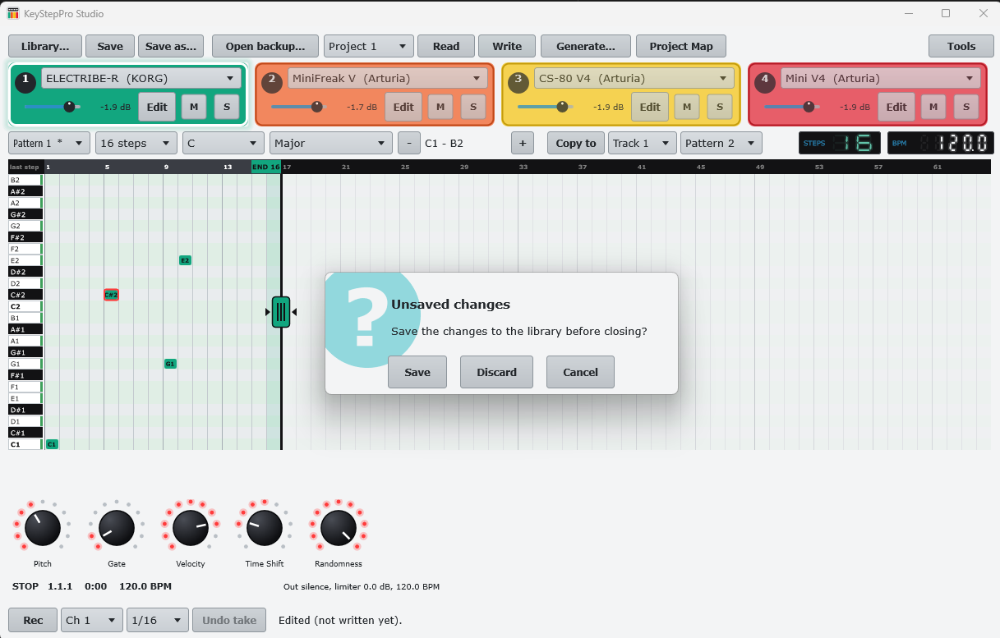
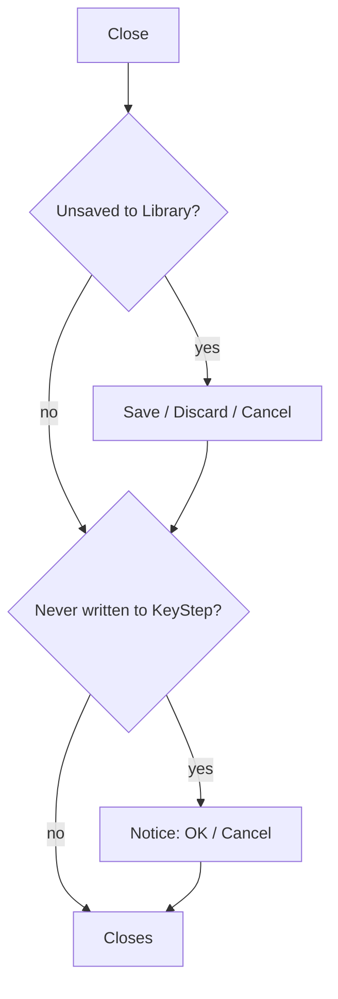

# 8. Save, Library and closing

**You will:** keep your projects safe on the computer and avoid losing edits.

## Library

**Library...** lists your projects (name, date, contents, instruments). **Open** (or double click), **Duplicate**,
**Delete**. They are files in `Documents\KeyStepPro Studio\Library\`, so you can back that folder up.

## Save

- **Save** puts the project into the Library. The first time it asks for a **name** (a project read from the KeyStep or
  opened from a backup is always new to the library); after that it overwrites.
- **Save as...** asks a name and keeps a new copy.
- The Library file also keeps the instruments (state, volume, mute) and the generator settings.

## Closing

If there are changes not saved to the Library, closing asks **Save / Discard / Cancel**.

 If the changes were never
written to the KeyStep, a second notice says so, with **OK / Cancel** to go back and write them.

> **Screenshots pending:** `shot-library.png`, `shot-close-warning.png`.

**Watch out:** at start the app opens the most recent Library project, with no KeyStep needed.
