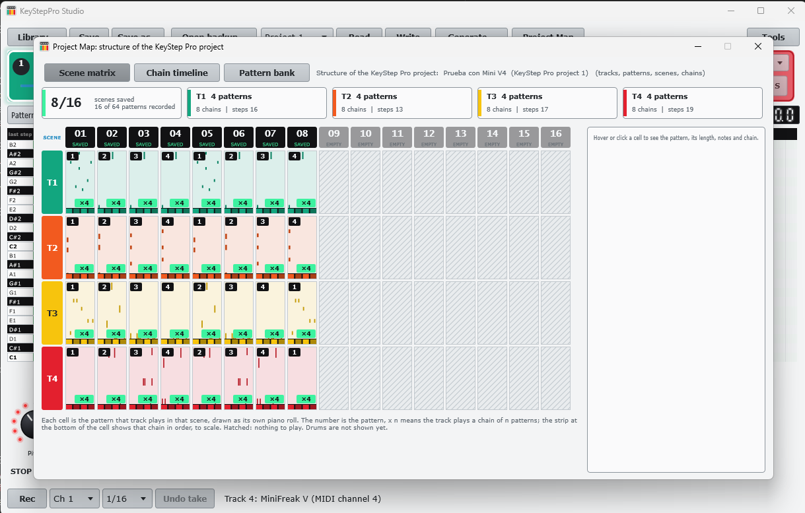
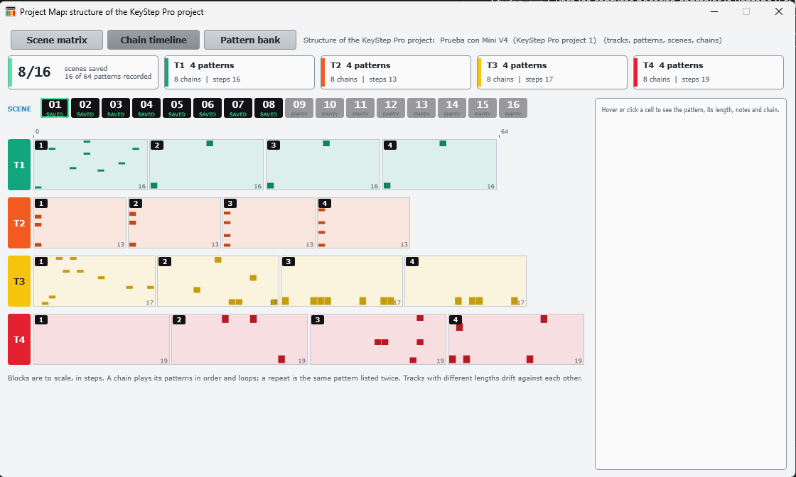

# 9. Project Map

**You will:** see the whole structure of the project at a glance: which pattern each track plays in each scene, how the chains run, and the pattern bank.

Click **Project Map** in the top row. It opens a window with three views; nothing in it changes your project.

## Scene matrix

1. The summary cards: how many scenes are saved and, per track, how many patterns, chains and steps.
2. Scenes 01-16 across the top (**SAVED** or **EMPTY**), tracks T1-T4 down the side in the KeyStep colours.
3. Each cell is the pattern that track plays in that scene, drawn as a small piano roll. The number is the pattern; `x4` means the track plays a chain of 4 patterns, shown in order on the strip at the bottom of the cell.
4. Hatched cells play nothing. Drums are not shown yet.
5. Hover or click a cell to see its pattern, length, notes and chain in the panel on the right.

## Chain timeline

Pick a scene and see each track's chain with its blocks drawn to scale in steps. Tracks with different lengths drift against each other, which is how a loop of 13 and a loop of 19 keep changing.

## Pattern bank

The third tab lists the patterns recorded in the project.
