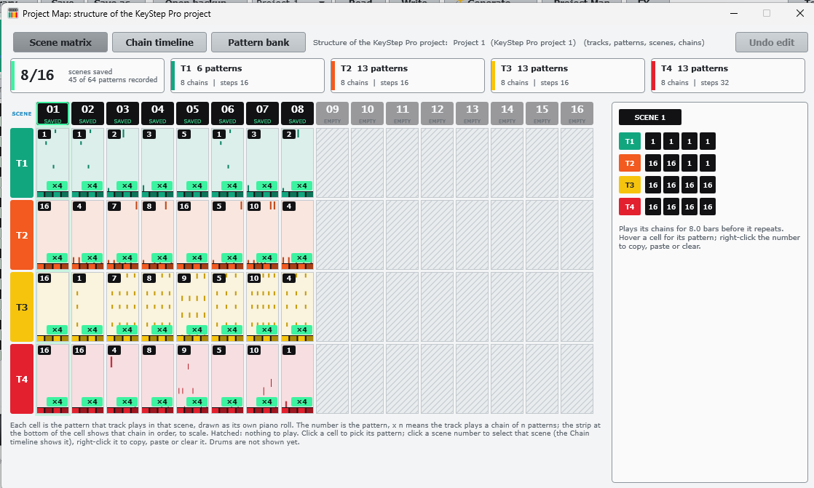
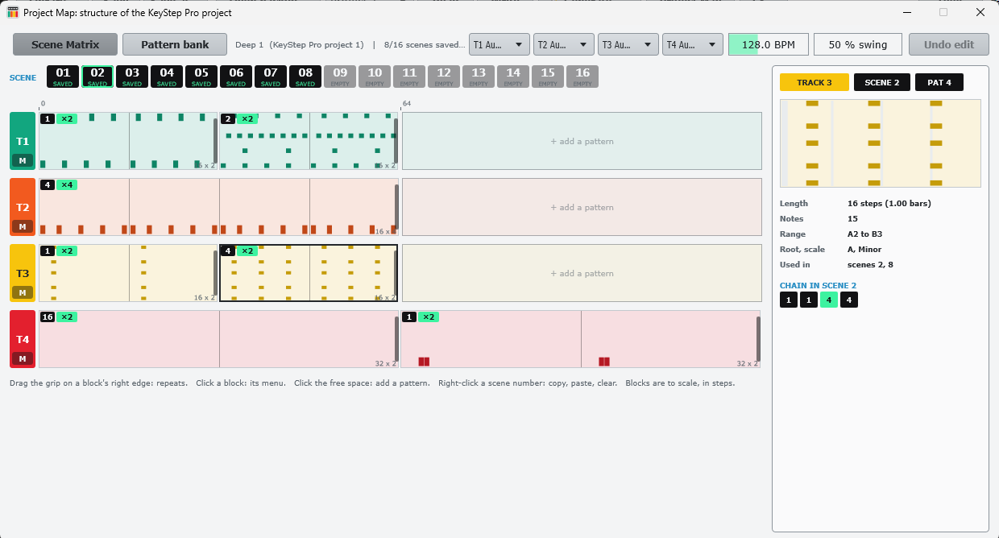

# 9. Project Map

**You will:** see the whole structure of the project at a glance: which pattern each track plays in each scene, how the chains run, and the pattern bank.

Click **Project Map** in the top row. It opens a window with three views. Only the Scene matrix edits the project (see below); the other two just show it.

## Scene matrix

1. The summary cards: how many scenes are saved and, per track, how many patterns, chains and steps.
2. Scenes 01-16 across the top (**SAVED** or **EMPTY**), tracks T1-T4 down the side in the KeyStep colours.
3. Each cell is the pattern that track plays in that scene, drawn as a small piano roll. The number is the pattern; `x4` means the track plays a chain of 4 patterns, shown in order on the strip at the bottom of the cell.
4. Hatched cells play nothing. Drums are not shown yet.
5. Hover a cell to see its pattern, length, notes and chain in the panel on the right. With no cell under the mouse, the panel shows the selected scene: each track's chain and how many bars it lasts.

When the window is too narrow for 16 scenes, the matrix scrolls sideways (mouse wheel, or Shift + wheel); the track names stay in place and the bar at the bottom shows where you are (drag it, or click on its track to jump).

### Editing scenes

- **Click a cell** and pick the pattern (1-16) that track plays in that scene. This removes that cell's chain; the menu also has *Remove the chain* to keep the pattern and drop the chain. Picking a pattern in an empty scene makes it a saved scene.
- **Click a scene number** to select that scene: its column stays highlighted, the panel on the right lists the chain of each
  track and how many bars the scene plays before it repeats, and the Chain timeline shows it.
- **Right-click a scene number** for **Copy**, **Paste** and **Clear** (back to an empty scene).
- **Undo edit** (top right) takes back the last change.

Picking a pattern in a scene that was empty saves the scene: the other three tracks get the first pattern with nothing recorded (silence), or pattern 1 if every pattern is used. Tracks may have chains of different lengths; they just loop against each other.

### Editing chains

The same cell menu edits the chain of that track in that scene (up to 16 patterns; the same pattern may appear more than once, and an empty pattern, e.g. 16, makes a silent bar):

- **Make a chain / Chain: add at the end** appends a pattern. With no chain yet, the chain starts with the pattern the cell already plays.
- **The arrows beside `xN`** (bottom right of each cell, `◀ x4 ▶`): `▶` adds one more copy of the chain's last pattern at the end, `◀` removes the last one. On a plain pattern (`x1`), `▶` makes it `x2`. This is the quick way to play a pattern 4 times.
- **Each position** (`1: pattern 3`) opens a small menu: *Move earlier*, *Move later*, *Repeat (duplicate)*, *Remove from the chain* and *Change to* another pattern. A chain left with one pattern becomes a plain pattern.

Edits are not saved and not on the KeyStep yet: use **Save** and **Write** as usual.

## Chain timeline

Pick a scene and see each track's chain with its blocks drawn to scale in steps. Tracks with different lengths drift against each other, which is how a loop of 13 and a loop of 19 keep changing.

## Pattern bank

The third tab lists the patterns recorded in the project.
