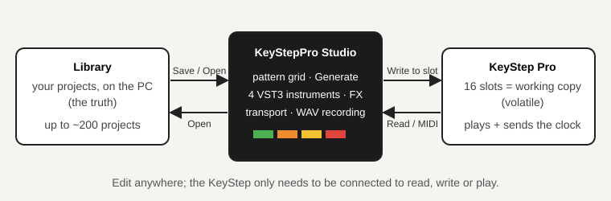

# KeyStepPro Studio — User guide

Short, task-oriented chapters. Each one says what you will do, how, and what to watch out for.
(The developer notes are one level up: [`../README.md`](../README.md).)

| # | Chapter | Status |
| --- | --- | --- |
| 1 | [Install and first run](01-install.md) | ready |
| 2 | [Connect the KeyStep](02-connect.md) | ready |
| 3 | [Read and write slots](03-slots.md) | ready |
| 4 | [Backups](04-backups.md) | ready |
| 5 | [The pattern grid](05-grid.md) | ready |
| 6 | [Tracks and instruments (VST3)](06-instruments.md) | ready |
| 7 | [Generate](07-generate.md) | ready |
| 8 | [Save, Library and closing](08-library.md) | ready |
| 9 | [Project Map](09-project-map.md) | ready |
| 9b | Tools menu | coming |
| 10 | Dragging steps in the grid | coming |
| 11 | Transport and WAV recording; MIDI monitor | next batch |

## Reading the pictures

- Diagrams in this guide are drawn, not photographed, so they stay valid when the look changes slightly.
- Screenshots come from the current build; the shot list, with what is still missing, is in
  [`SCREENSHOTS.md`](SCREENSHOTS.md).
- Track colours match the KeyStep: **T1** green, **T2** orange, **T3** yellow, **T4** red.

## The three ideas to keep in mind

1. **The Library is the truth.** Projects live on your computer. The KeyStep's 16 slots are a temporary working copy.
2. **The KeyStep is read from flash.** The app sees what you *saved* on the KeyStep, not what is playing right now.
   Save on the KeyStep before reading.
3. **Nothing is written without a backup.** Every write backs the slot up first and reads it back afterwards.
